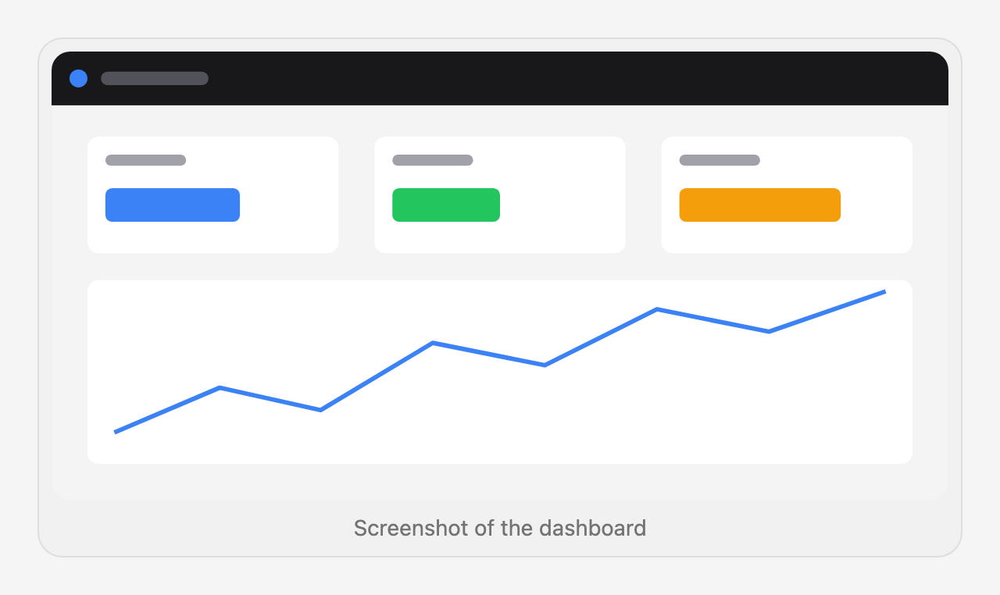
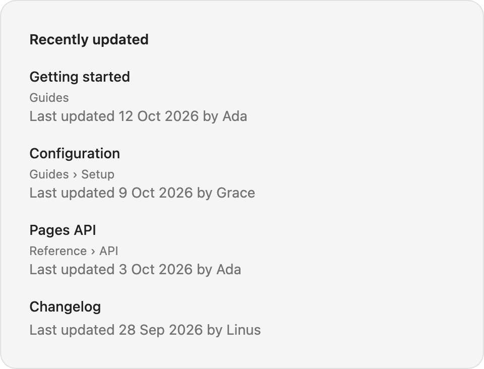
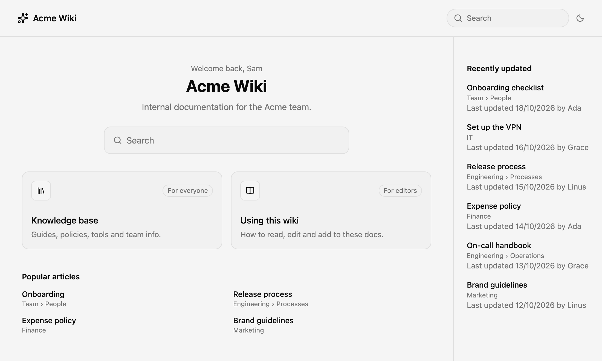

# fumadocs-components

Copy-paste UI components for [Fumadocs](https://fumadocs.dev) wikis. Not an npm package — copy the components you need into your project and customize them.

These components use Fumadocs CSS variables (`fd-border`, `fd-primary`, etc.) for seamless theme integration. They work out of the box with any Fumadocs project.

## Components

### Frame

Content frame with click-to-zoom on images.

<picture>
  <source media="(prefers-color-scheme: dark)" srcset="docs/previews/frame-dark.png">
  
</picture>

**Dependencies:** `pnpm add react-medium-image-zoom`

```tsx
import { Frame } from '@/components/frame';

<Frame caption="Screenshot of the dashboard">
  
</Frame>
```

| Prop | Type | Default | Description |
|------|------|---------|-------------|
| `children` | `ReactNode` | — | Content (images are automatically wrapped with zoom) |
| `caption` | `string` | — | Caption text below the frame |
| `className` | `string` | `''` | Additional CSS classes |

---

### Columns

Responsive CSS grid wrapper.

**Dependencies:** none

```tsx
import { Columns } from '@/components/columns';

<Columns cols={3}>
  <div>Column 1</div>
  <div>Column 2</div>
  <div>Column 3</div>
</Columns>
```

| Prop | Type | Default | Description |
|------|------|---------|-------------|
| `children` | `ReactNode` | — | Column content |
| `cols` | `number` | `2` | Number of columns |
| `className` | `string` | `''` | Additional CSS classes |

---

### Icon

Dynamic Lucide icon renderer. Pass icon names as strings (useful in MDX).

**Dependencies:** `pnpm add lucide-react`

```tsx
import { Icon } from '@/components/icon';

<Icon name="arrow-right" size={20} />
<Icon name="check-circle" color="green" />
```

| Prop | Type | Default | Description |
|------|------|---------|-------------|
| `name` | `string` | — | Lucide icon name (kebab-case) |
| `size` | `number` | `24` | Icon size in pixels |
| `color` | `string` | `'currentColor'` | Icon color |
| `strokeWidth` | `number` | `2` | Stroke width |
| `className` | `string` | `''` | Additional CSS classes |
| `aria-label` | `string` | — | Accessible label |

---

### Tooltip

Hover tooltip with optional call-to-action link.

**Dependencies:** none

```tsx
import { Tooltip } from '@/components/tooltip';

<Tooltip tip="This is a helpful explanation">
  hover me
</Tooltip>

<Tooltip tip="Learn more about this feature" cta="Read docs" href="/docs/feature">
  with a link
</Tooltip>
```

| Prop | Type | Default | Description |
|------|------|---------|-------------|
| `tip` | `string` | — | Tooltip text |
| `cta` | `string` | — | Call-to-action button text |
| `href` | `string` | — | CTA link URL (required if `cta` is set) |
| `children` | `ReactNode` | — | Trigger content |
| `className` | `string` | `''` | Additional CSS classes |

---

### Color

Color palette display with click-to-copy. Supports compact grid and table variants, light/dark theme-aware colors, and all CSS color formats (hex, rgb, hsl, oklch).

**Dependencies:** none

```tsx
import { Color, ColorItem, ColorRow } from '@/components/color';

{/* Compact grid */}
<Color variant="compact">
  <ColorItem name="Blue" value="#3b82f6" />
  <ColorItem name="Red" value="#ef4444" />
</Color>

{/* Table with rows */}
<Color variant="table">
  <ColorRow title="Primary">
    <ColorItem value="#3b82f6" />
    <ColorItem value="#2563eb" />
  </ColorRow>
</Color>

{/* Theme-aware */}
<ColorItem name="Background" value={{ light: '#ffffff', dark: '#0a0a0a' }} />
```

| Component | Prop | Type | Description |
|-----------|------|------|-------------|
| `Color` | `variant` | `'compact' \| 'table'` | Layout variant |
| `ColorItem` | `name` | `string` | Color label |
| `ColorItem` | `value` | `string \| { light, dark }` | CSS color value(s) |
| `ColorRow` | `title` | `string` | Row label (table variant) |

---

### Update

Changelog/update entry with sticky labels, tags, and anchor links.

**Dependencies:** none

```tsx
import { Update } from '@/components/update';

<Update label="v2.1.0" description="Jan 15, 2025" tags={["feature", "breaking"]}>
  Added dark mode support and redesigned the settings page.
</Update>
```

| Prop | Type | Default | Description |
|------|------|---------|-------------|
| `label` | `string` | — | Version or date label |
| `description` | `string` | — | Subtitle text |
| `tags` | `string[]` | — | Category tags |
| `children` | `ReactNode` | — | Update content (MDX) |
| `className` | `string` | `''` | Additional CSS classes |

---

### Steps

Numbered step-by-step procedures with multiple counter styles and custom icons.

**Dependencies:** `pnpm add tailwind-merge`

**Setup:** Copy `components/steps/` and import the CSS in your layout or `mdx-components.tsx`:

```tsx
import { Steps, Step } from '@/components/steps/steps';
import '@/components/steps/styles/steps.css';

<Steps>
  <Step title="Install dependencies">
    Run `pnpm add fumadocs-core`.
  </Step>
  <Step title="Configure">
    Add the config file.
  </Step>
</Steps>

{/* Roman numerals */}
<Steps type="upper-roman">
  <Step title="First">...</Step>
</Steps>

{/* Custom icons */}
<Step title="Done" icon={<CheckIcon />}>...</Step>
```

| Component | Prop | Type | Default | Description |
|-----------|------|------|---------|-------------|
| `Steps` | `type` | `'decimal' \| 'lower-alpha' \| 'upper-alpha' \| 'lower-roman' \| 'upper-roman'` | `'decimal'` | Counter style |
| `Steps` | `titleSize` | `'p' \| 'h2' \| 'h3'` | `'p'` | Heading level for step titles |
| `Step` | `title` | `ReactNode` | — | Step title |
| `Step` | `icon` | `ReactNode` | — | Custom icon (overrides number) |

---

### RecentlyUpdatedList

List of recently changed pages: a link, an optional small line under it (such as the section) and an optional line under that (such as "Last updated 12 Oct by Ada"). It only lays out the list. It fetches nothing and holds no state, so every piece of text comes in through `items` and you decide where the data comes from.

Works in server and client components. It renders nothing when `items` is empty.

<picture>
  <source media="(prefers-color-scheme: dark)" srcset="docs/previews/recently-updated-list-dark.png">
  
</picture>

**Dependencies:** none beyond `next/link` and Tailwind with the Fumadocs tokens.

```tsx
import { RecentlyUpdatedList } from '@/components/recently-updated-list';

<RecentlyUpdatedList
  title="Recently updated"
  items={[
    {
      href: '/docs/getting-started',
      title: 'Getting started',
      trail: 'Guides',
      meta: 'Last updated 12 Oct by Ada',
    },
    { href: '/docs/api', title: 'API reference', trail: 'Reference' },
  ]}
/>
```

| Prop | Type | Default | Description |
|------|------|---------|-------------|
| `items` | `RecentlyUpdatedItem[]` | — | The entries to show, in the order given |
| `title` | `ReactNode` | — | Heading above the list. No heading when left out |
| `className` | `string` | — | Classes for the wrapping `div` |

Each item:

| Field | Type | Default | Description |
|-------|------|---------|-------------|
| `href` | `string` | — | Link target. Also used as the React key, so keep it unique |
| `title` | `ReactNode` | — | Link text |
| `trail` | `ReactNode` | — | Small line under the title, e.g. the section |
| `meta` | `ReactNode` | — | Line under that, e.g. date and author. Pass your own element to format it however you like |

The list has no wording of its own, so there is nothing to translate. Dates and authors are formatted by you, in `meta`.

#### Example: wiki front page

The list works well as a sidebar next to the main content of a landing page:

<picture>
  <source media="(prefers-color-scheme: dark)" srcset="docs/previews/wiki-home-dark.png">
  
</picture>

```tsx
<div className="grid grid-cols-[1fr_17rem]">
  <main className="px-10 py-12">{/* hero, search, cards, popular articles */}</main>
  <aside className="border-l border-fd-border px-6 py-12">
    <RecentlyUpdatedList title="Recently updated" items={items} />
  </aside>
</div>
```

The full page is `demo/src/demo/wiki-home-example.tsx`.

#### Feeding it data

Sorting, filtering and date lookup are yours to write, because they depend on where your dates come from. A wrapper can be this small:

```tsx
import { source } from '@/lib/source';
import { RecentlyUpdatedList } from '@/components/recently-updated-list';

export function RecentlyUpdated({ limit = 8 }: { limit?: number }) {
  const items = source
    .getPages()
    // `lastModified` is whatever date you have: a plugin, frontmatter, a CMS field.
    .filter((page) => page.data.lastModified)
    .sort((a, b) => b.data.lastModified!.getTime() - a.data.lastModified!.getTime())
    .slice(0, limit)
    .map((page) => ({
      href: page.url,
      title: page.data.title,
      trail: page.path.split('/').slice(0, -1).join(' › '),
      meta: `Last updated ${page.data.lastModified!.toLocaleDateString('en-GB')}`,
    }));

  return <RecentlyUpdatedList title="Recently updated" items={items} />;
}
```

A real project can put more behind the same shape: dates and authors from `git log` (read again on every request in dev), folder titles from each `meta.json` for `trail`, and a `section` option to limit the list to one folder. None of that is part of the list component.

---

## MDX Registration

Register components in your `mdx-components.tsx`:

```tsx
import { Frame } from '@/components/frame';
import { Columns } from '@/components/columns';
import { Icon } from '@/components/icon';
import { Tooltip } from '@/components/tooltip';
import { Color, ColorItem, ColorRow } from '@/components/color';
import { Update } from '@/components/update';
import { Steps, Step } from '@/components/steps/steps';
import '@/components/steps/styles/steps.css';

export function getMDXComponents(components?: MDXComponents): MDXComponents {
  return {
    ...defaultMdxComponents,
    Frame,
    Columns,
    Icon,
    Tooltip,
    Color,
    ColorItem,
    ColorRow,
    Update,
    Steps,
    Step,
    ...components,
  };
}
```

`RecentlyUpdatedList` is not in this list on purpose. It is safe in client bundles, but an MDX author cannot supply `items`, so there is nothing useful to write in a page. Render it from a page or layout, or from a wrapper like the one above.

## Theming

Components use Fumadocs CSS variables with sensible fallbacks:

| Variable | Used by |
|----------|---------|
| `--color-fd-border` | Frame, Tooltip, Update, Steps |
| `--color-fd-secondary` | Frame, Update, Steps |
| `--color-fd-primary` | Tooltip, Update |
| `--color-fd-foreground` | Tooltip, Color, Steps |
| `--color-fd-muted-foreground` | Frame, Tooltip, Color, Update, Steps, RecentlyUpdatedList |
| `--color-fd-card` | Tooltip |
| `--color-fd-secondary-foreground` | Steps |

These are set automatically by `fumadocs-ui`. If using outside Fumadocs, define these variables in your CSS.

## Previews

The screenshots in this README are generated from a small Fumadocs site in `demo/`. It copies `components/` into itself, renders each component on its own page, and Playwright saves a light and a dark PNG of every `data-preview` wrapper to `docs/previews/`.

```bash
cd demo
pnpm install
pnpm exec playwright install chromium   # first time only
pnpm previews                           # build, screenshot, write docs/previews/*.png
pnpm dev                                # browse the demo at http://localhost:3000
```

To add a component: add `demo/content/docs/<name>.mdx` with the component inside a `<div data-preview="<name>">`, register it in `demo/src/mdx-components.tsx`, then run `pnpm previews`. Fonts come from your system, so regenerate on the same machine when updating existing screenshots to keep diffs small.

## License

MIT
